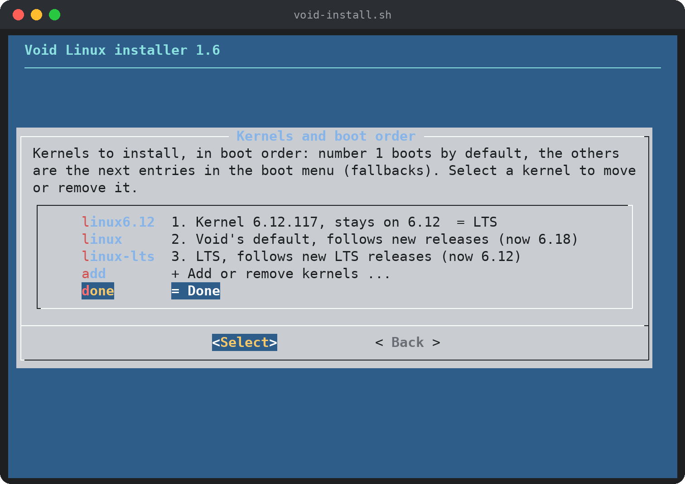
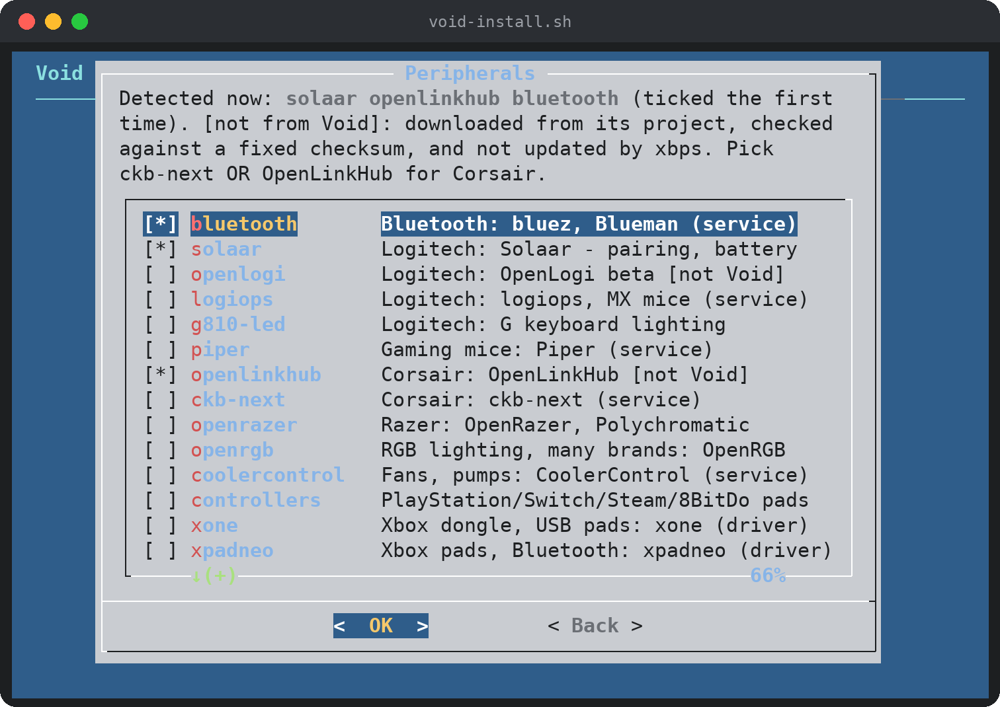
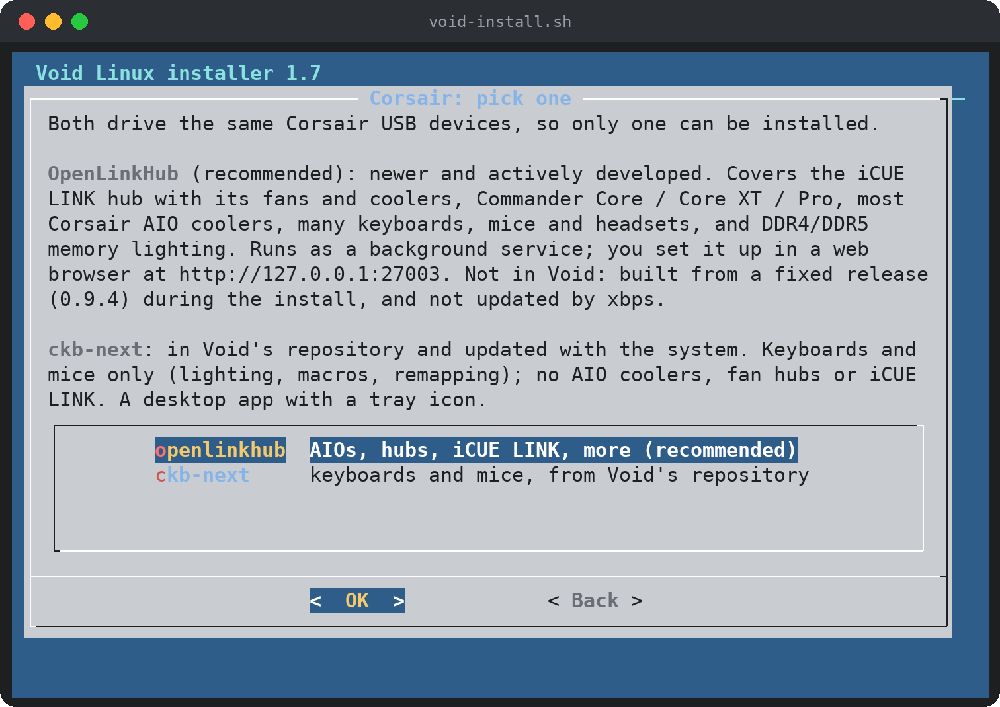
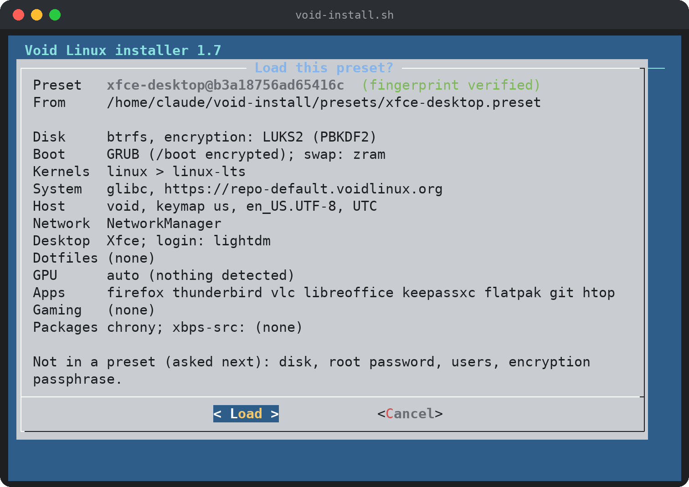

<div align="center">

# void-install

**A menu-driven installer for [Void Linux](https://voidlinux.org).**
One script, one disk, a full system: encryption, your choice of boot loader,
desktops or window managers, and popular dotfiles.

[](LICENSE)


</div>

> [!WARNING]
> **The disk you select is erased completely.** There is no dual-boot mode.
> Back up anything you need first.

## Quick start

Boot an official [Void Linux live image](https://voidlinux.org/download/),
log in as `root` (password `voidlinux`), get online, then:

```sh
xbps-fetch https://raw.githubusercontent.com/aranmi-git/void-install/main/void-install.sh
bash void-install.sh
```

Set the options in the menu and choose **Install**. Only four items are
required: the disk, the root password, a user, and (if you encrypt) a
passphrase. Everything else has a sensible default.

Or start from a preset and answer only the disk, passwords and users:

```sh
bash void-install.sh --preset xfce-desktop
```

The full guide is in the [manual (PDF)](docs/void-install-manual.pdf).

## What it can do

| | |
|---|---|
| **Firmware** | UEFI (64-bit or 32-bit) and legacy BIOS, on GPT |
| **Filesystem** | ext4, or btrfs with subvolumes (`@`, `@home`, `@snapshots`, ...) |
| **Encryption** | none, LUKS1 or LUKS2 on the root partition |
| **Boot loader** | GRUB, Limine, systemd-boot, rEFInd, UKI, EFISTUB, SYSLINUX/EXTLINUX |
| **Kernels** | any of Void's kernels (default, LTS, mainline, or a fixed series such as 6.6), in the boot order you choose |
| **Swap** | zram, swap file, or none |
| **C library** | glibc or musl |
| **Desktops** | Xfce, KDE Plasma, GNOME, MATE, Cinnamon, LXQt, Budgie, LXDE, Enlightenment |
| **Window managers** | i3, bspwm, dwm, awesome, Qtile, herbstluftwm, Openbox, Fluxbox, IceWM, spectrwm, LeftWM, Sway, niri, river, labwc, Wayfire |
| **Login screen** | LightDM, SDDM, GDM, greetd + tuigreet, or none |
| **Dotfiles** | 20 presets: CachyOS, EndeavourOS, Garuda, LARBS, gh0stzk, Chris Titus |
| **Graphics** | Intel, AMD, NVIDIA (several driver series), virtual machines; auto-detected |
| **Software** | common applications, Steam / Wine / Lutris with 32-bit libraries, Flatpak |
| **Users** | several users, each with a sudo level |
| **Peripherals** | Logitech, Corsair, Razer, RGB, fans, controllers, wheels, tablets, Bluetooth, key remappers; background services set up for runit |
| **Presets** | save all settings to a file; reinstall with only disk, passwords and users; fingerprint-checked IDs |
| **Extras** | xbps-src package builds, LARBS-style bootstrap from a programs list |

<div align="center">


</div>

### Desktops and window managers

Pick as many as you like; each becomes a session on the login screen. Every
window manager comes with a full set of everyday tools (terminal, launcher,
bar, notifications, file manager, screen lock, screenshots, volume and
brightness keys, fonts).

On the login screen, choose the entry ending in **"(Void session)"**. It
starts the window manager with a D-Bus session and PipeWire, so sound and
notifications work. The plain entry is the package's own and starts the bare
window manager.

### Kernels and boot order

Install any combination of Void's kernels and put them in the order you want:
the first boots by default, the others are the next entries in the boot menu.
The list is read from Void's repository, so new kernels show up without an
update to the script.

<div align="center">

</div>

After installing, change the order in `/etc/default/kernel-order` and refresh
the boot menu (`sudo update-grub`, `sudo update-limine` or
`sudo update-boot-menu`).

### Peripherals

Tick what you own; what is plugged in during the install is ticked for you.
Programs that run in the background get a runit service, enabled at boot.

| Devices | Tools |
|---|---|
| Logitech | Solaar, logiops (service), g810-led, OpenLogi* |
| Corsair | OpenLinkHub* (service, web UI on port 27003) **or** ckb-next (service) |
| Razer | OpenRazer + Polychromatic |
| Gaming mice | Piper (service) |
| RGB, fans | OpenRGB, CoolerControl (service) |
| Controllers, wheels | xone, xpadneo, PlayStation/Switch/Steam access rules, SC Controller, AntiMicroX, Oversteer |
| Other | Bluetooth (service), Wacom tablets, input-remapper (service), keyd (service), kanata |

\* Not in Void's repository: installed from a pinned release or commit,
checked against a fixed checksum or signature-verified hash, and **not updated
by xbps**. Everything else comes from Void's repository.

OpenLinkHub and ckb-next drive the same Corsair devices, so the menu lets you
pick one. OpenLinkHub covers much more (iCUE LINK, AIO coolers, Commander
hubs, memory lighting); ckb-next is in Void's repository and updates with
the system, but handles only keyboards and mice.

<div align="center">


</div>

### Presets

A preset is a small text file with every setting except the disk, the
passwords and the users. Save one from the **Preset** menu item, then load it
on any computer:

| Load from | Example |
|---|---|
| a name in [`presets/`](presets) | `--preset gaming-kde` |
| a file | `--preset /mnt/usb/my.preset` |
| an https link | `--preset https://example.org/my.preset` |

Every preset has an ID, for example `xfce-desktop@b3a18756ad65416c`: the
name plus a fingerprint (SHA-256) of its settings. Add the `@...` part when
loading and the installer refuses a preset that was changed. Each install
also leaves its settings in `/root/void-install.preset`.

<div align="center">

</div>

A preset cannot run commands: only known settings are read, and each is
checked. It can name a programs list or dotfiles repository, which do run
code; the load screen points these out. Example presets:

| Name | ID | What it installs |
|---|---|---|
| `minimal` | `minimal@6d574c6ac315d064` | console server: LTS kernel, dhcpcd, SSH |
| `xfce-desktop` | `xfce-desktop@b3a18756ad65416c` | Xfce with everyday apps, btrfs |
| `kde-desktop` | `kde-desktop@818844b9fa853e35` | KDE Plasma with SDDM, btrfs |
| `sway-wayland` | `sway-wayland@88b23e89577d0c6a` | Sway with EndeavourOS dotfiles, greetd |
| `i3-cachyos` | `i3-cachyos@a0a215974ad079f5` | i3 with CachyOS dotfiles |
| `gaming-kde` | `gaming-kde@04206733a1ab82c9` | KDE, Steam, Wine, Lutris, GameMode, Discord |

All use LUKS2 encryption and GRUB; change anything in the menu after loading.

### Boot loaders

All of them follow your kernel order. The menu is rewritten automatically
whenever a kernel is installed or removed. Limine also refreshes itself after
a Limine package update.

Secure Boot must be off: none of the boot loaders is signed.

## After installing

Run the same script on the installed system to add users, programs or
dotfiles later:

```sh
sudo bash void-install.sh --bootstrap
```

Other options: `--preset`, `--help`, `--version`.

## Project status

Version 1.7. See the [changelog](CHANGELOG.md) for what changed and exactly
what was tested.

Tested so far: the base install, configuration, users, passwords and the
package step on a real Void system; Limine booting in an emulator on BIOS and
UEFI; most window managers launched on a test machine. **A complete install
on real hardware, start to finish, has not been verified yet**, and the newer
boot loaders (systemd-boot, rEFInd, UKI, EFISTUB, SYSLINUX) have only been
checked in simulation. Try it in a virtual machine first, and please report
what you find.

## Contributing

Bug reports and pull requests are welcome. When reporting a failed install,
attach `/tmp/void-install.log` from the live system. Passwords are never
written to it, and credentials inside URLs are masked.

## License

[GNU General Public License, version 2](LICENSE). This program comes with
no warranty.

The dotfile presets are downloaded from their own repositories at install
time and remain under their authors' licenses; none are included here.
