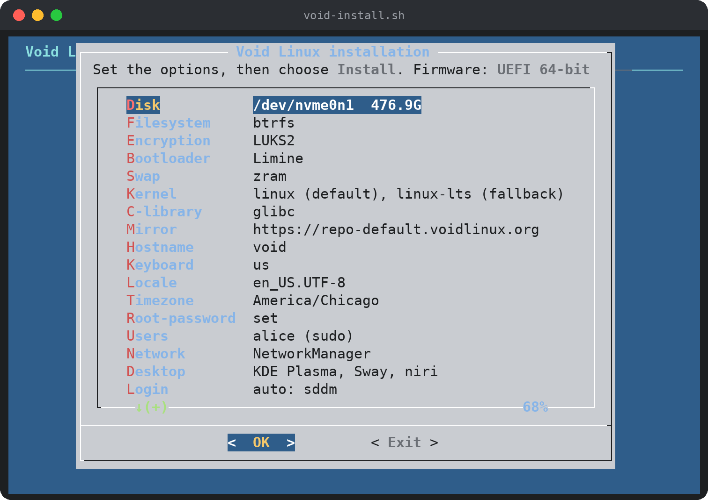
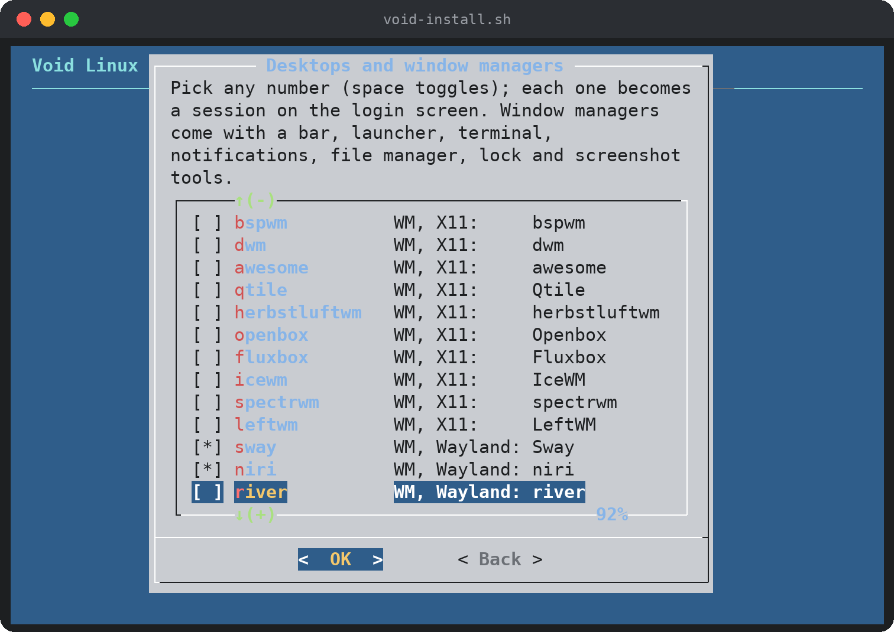
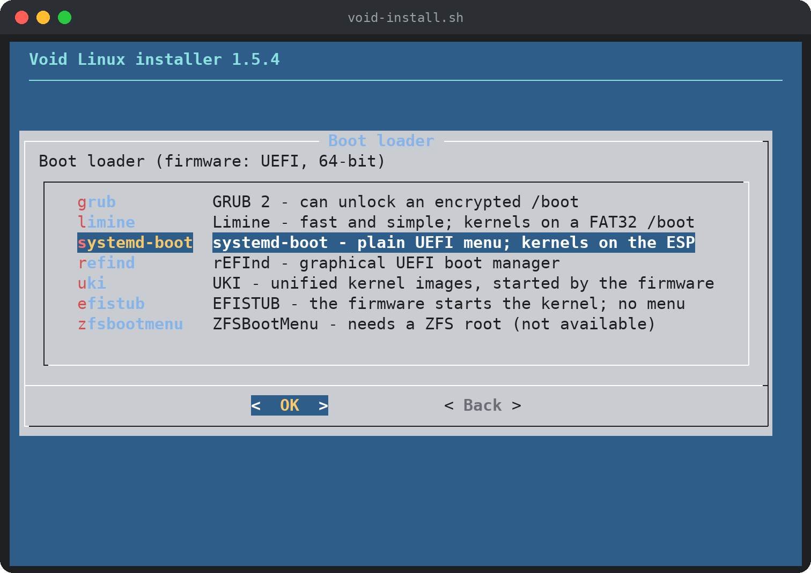

<div align="center">

# void-install

**A menu-driven installer for [Void Linux](https://voidlinux.org).**
One script, one disk, a full system: encryption, your choice of boot loader,
desktops or window managers, and popular dotfiles.

[](LICENSE)




</div>

> [!WARNING]
> **The disk you select is erased completely.** There is no dual-boot mode.
> Back up anything you need first.

## Quick start

Boot an official [Void Linux live image](https://voidlinux.org/download/),
log in as `root` (password `voidlinux`), get online, then:

```sh
xbps-fetch https://raw.githubusercontent.com/aranmi-git/void-install/main/void-install.sh
bash void-install.sh
```

Set the options in the menu and choose **Install**. Only four items are
required: the disk, the root password, a user, and (if you encrypt) a
passphrase. Everything else has a sensible default.

The full guide is in the [manual (PDF)](docs/void-install-manual.pdf).

## What it can do

| | |
|---|---|
| **Firmware** | UEFI (64-bit or 32-bit) and legacy BIOS, on GPT |
| **Filesystem** | ext4, or btrfs with subvolumes (`@`, `@home`, `@snapshots`, ...) |
| **Encryption** | none, LUKS1 or LUKS2 on the root partition |
| **Boot loader** | GRUB, Limine, systemd-boot, rEFInd, UKI, EFISTUB, SYSLINUX/EXTLINUX |
| **Kernels** | the normal `linux` kernel always boots by default; LTS is the fallback; mainline optional |
| **Swap** | zram, swap file, or none |
| **C library** | glibc or musl |
| **Desktops** | Xfce, KDE Plasma, GNOME, MATE, Cinnamon, LXQt, Budgie, LXDE, Enlightenment |
| **Window managers** | i3, bspwm, dwm, awesome, Qtile, herbstluftwm, Openbox, Fluxbox, IceWM, spectrwm, LeftWM, Sway, niri, river, labwc, Wayfire |
| **Login screen** | LightDM, SDDM, GDM, greetd + tuigreet, or none |
| **Dotfiles** | 20 presets: CachyOS, EndeavourOS, Garuda, LARBS, gh0stzk, Chris Titus |
| **Graphics** | Intel, AMD, NVIDIA (several driver series), virtual machines; auto-detected |
| **Software** | common applications, Steam / Wine / Lutris with 32-bit libraries, Flatpak |
| **Users** | several users, each with a sudo level |
| **Extras** | xbps-src package builds, LARBS-style bootstrap from a programs list |

<div align="center">


</div>

### Desktops and window managers

Pick as many as you like; each becomes a session on the login screen. Every
window manager comes with a full set of everyday tools (terminal, launcher,
bar, notifications, file manager, screen lock, screenshots, volume and
brightness keys, fonts).

On the login screen, choose the entry ending in **"(Void session)"**. It
starts the window manager with a D-Bus session and PipeWire, so sound and
notifications work. The plain entry is the package's own and starts the bare
window manager.

### Boot loaders

All of them boot the normal kernel by default and list LTS second. The menu
is rewritten automatically whenever a kernel is installed or removed. Limine
also refreshes itself after a Limine package update.

Secure Boot must be off: none of the boot loaders is signed.

## After installing

Run the same script on the installed system to add users, programs or
dotfiles later:

```sh
sudo bash void-install.sh --bootstrap
```

Other options: `--help`, `--version`.

## Project status

Version 1.5.4. See the [changelog](CHANGELOG.md) for what changed and exactly
what was tested.

Tested so far: the base install, configuration, users, passwords and the
package step on a real Void system; Limine booting in an emulator on BIOS and
UEFI; most window managers launched on a test machine. **A complete install
on real hardware, start to finish, has not been verified yet**, and the newer
boot loaders (systemd-boot, rEFInd, UKI, EFISTUB, SYSLINUX) have only been
checked in simulation. Try it in a virtual machine first, and please report
what you find.

## Contributing

Bug reports and pull requests are welcome. When reporting a failed install,
attach `/tmp/void-install.log` from the live system. Passwords are never
written to it, and credentials inside URLs are masked.

## License

[GNU General Public License, version 2](LICENSE). This program comes with
no warranty.

The dotfile presets are downloaded from their own repositories at install
time and remain under their authors' licenses; none are included here.
